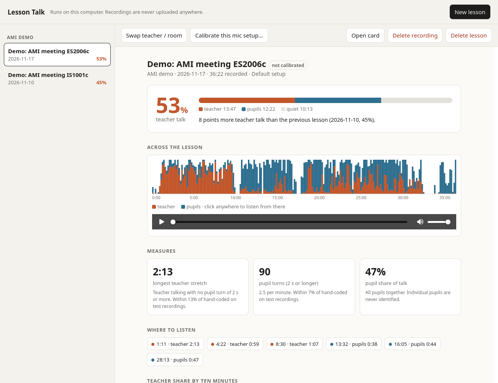

# Lesson Talk

How much of a lesson is teacher talk, measured on the school's own computer.
Record a lesson with a lapel mic on the teacher and a mic at the back of the
room. A minute or so after the lesson you get a one-page card: teacher share of talk,
longest teacher stretch, pupil turns, a timeline you can click to listen
from, and the trend across lessons for that class.

No cloud, no GPU, no transcription, no language model, and no pupil is ever
identified. The product spec and the evidence behind it are in
[`SPEC-talk.md`](SPEC-talk.md).



*The demo lessons are two AMI corpus meetings (CC BY 4.0), uncalibrated, not
classroom recordings.*

`tools/build_demo.py` turns a lesson library into a single read-only demo
page with numbers only and no audio, which can be shared as a link.

## Run it

```sh
./lesson-talk                       # opens the app at http://127.0.0.1:8765
./lesson-talk report lesson.wav     # or: one card from the command line
./lesson-talk report --near lapel.wav --far room.wav
```

Needs Python 3.12+ and the whisper.cpp speech-detection binary and Silero
model under `vendor/` and `models/` (override them with `LESSONTALK_VAD_BIN`
and `LESSONTALK_VAD_MODEL`). No Python packages. Lessons are kept in
`~/LessonTalk` (`LESSONTALK_HOME`).

### Setup

The repo holds code and results only. The speech detector and the test data
are fetched separately:

```sh
# whisper.cpp (built at commit c1a2404) provides the Silero VAD binary
git clone https://github.com/ggml-org/whisper.cpp vendor/whisper.cpp
cmake -S vendor/whisper.cpp -B vendor/whisper.cpp/build && \
  cmake --build vendor/whisper.cpp/build -j --target whisper-vad-speech-segments
# Silero VAD model, ggml format
mkdir -p models && curl -L -o models/ggml-silero-v5.1.2.bin \
  https://huggingface.co/ggml-org/whisper-vad/resolve/main/ggml-silero-v5.1.2.bin
```

For `tools/validate_ami.py` and the end-to-end tests, put the AMI corpus
(CC BY 4.0) manual annotations under `data/ami/annotations/extracted/` and
the `Lapel-0` and `Array1-01` WAVs for IS1001c and ES2006c under
`data/ami/audio/`, from the
[AMI corpus mirror](https://groups.inf.ed.ac.uk/ami/download/). The tests
that need them are skipped when they are absent.

### Testing it as a team member

See [`docs/TESTING.md`](docs/TESTING.md): signing in to the team server,
what the three sample lessons should show, adding a lesson from open AMI
recordings, and how to report problems.

### Running it for a team

On one machine the app needs no accounts and only answers on 127.0.0.1. To
share it, create accounts first; once any account exists, every request
needs one:

```sh
./lesson-talk add-user asha          # prints a generated password once
./lesson-talk list-users
./lesson-talk remove-user asha
```

Then put it behind HTTPS and tell it the public hostname, e.g. with
Tailscale Funnel:

```sh
LESSONTALK_ALLOWED_HOSTS=myhost.tailnet.ts.net ./lesson-talk serve --port 8102 --no-browser
sudo tailscale funnel --bg --https=8443 http://127.0.0.1:8102
```

A shared server stores recordings on that server, so the "never leaves the
computer" promise no longer holds: use it with test recordings, and do a
DPIA before any real pupil audio goes near it. The app says so in its header
when accounts are on.

**Recording:** one recorder with two inputs (lapel on one channel, room mic
on the other) is simplest. Two separate recorders also work: they are lined
up automatically if they were started within 30 s of each other. WAV, 16 or
24 bit.

**Calibration:** one hand-coded *typical* lesson per mic setup. Time teacher
talk against pupil talk, enter the teacher's share, and every lesson on that
setup is recomputed.

## How accurate

Run through the product code on two AMI meetings, with Lapel-0 as the teacher's lapel mic and
the far-field array as the room mic (`tools/validate_ami.py`). AMI meetings
are ~47% "teacher", so each is also re-run with most other-speaker stretches
cut out, which brings the teacher share up to lesson-like levels:

| | IS1001c | ES2006c |
|---|---|---|
| teacher share, setup calibrated on a ~75% lesson, true 47 / ~76 / ~86% | 46.8 / 73.0 / 82.8 (true 47.1 / 73.0 / 83.7) | 52.5 / 78.9 / 85.3 (true 47.3 / 78.9 / 88.6) |
| teacher share, uncalibrated | within 4.2 points | within 5.4 points |
| longest teacher stretch | 136 s vs 137 s | 133 s vs 153 s (−13%) |
| pupil turns ≥ 2 s | 74 vs 78 | 90 vs 97 |

On every lesson-like row the calibrated error is 3.3 points or less. Pushed down to a
balanced 47% lesson, the error grows to 5.2. Carrying one meeting's calibration to the other gives up to 7.6.
A third meeting, **ES2002a, fails**, and it was not used to tune anything.
Its lapel cuts out for 7% of the meeting, which the app now detects, warns
about and leaves out. Its wearer speaks only 11% of the time, and a loud
neighbour on the same lapel is counted as the teacher, so it reads 56%.
The app does not detect that second problem yet (`docs/TESTING.md`).
These are seated adults in meeting rooms. **No classroom recording has been
tested yet**, and that is the next gate (spec section 8).

## Layout

```
lessontalk/   the product: audio.py, engine.py, report.py, store.py, server.py, app.html
tools/        validate_ami.py, the end-to-end accuracy check
tests/        python3 -m unittest discover -s tests
src/, bench/  the research that led here (VAD, attribution, Kev latency)
```

## Licence

MIT, see [`LICENSE`](LICENSE). The AMI corpus data used for validation is
CC BY 4.0 and is not included.
